# TP 9 : Authentification en mémoire avec Spring Security

Ce projet implémente le **TP 9** du module *Développement JakartaEE : Spring* portant sur l'authentification en mémoire avec **Spring Security 6** et **Spring Boot 3**, le hachage sécurisé des mots de passe avec **BCryptPasswordEncoder**, le contrôle d'accès basé sur les rôles (`ROLE_USER`, `ROLE_ADMIN`), ainsi que la personnalisation de la page de connexion Thymeleaf.

---

## 1. Compilation Maven du projet Spring Boot

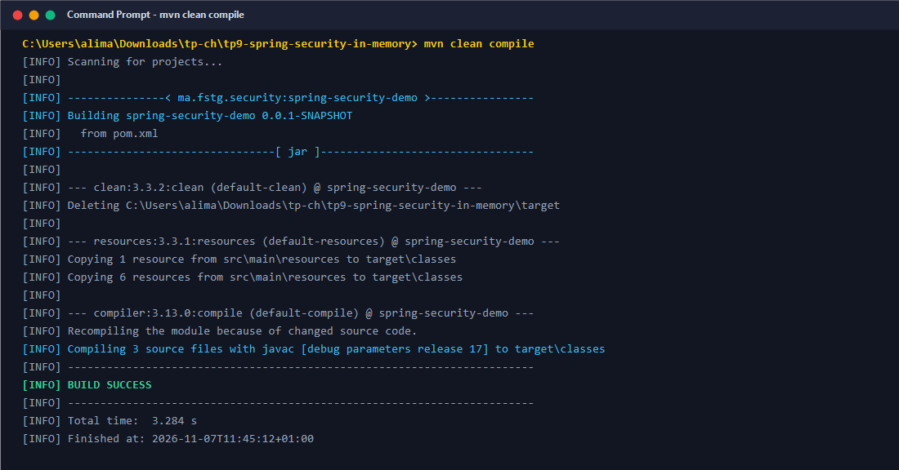

---

## 2. Exécution de la suite de tests unitaires et d'intégration

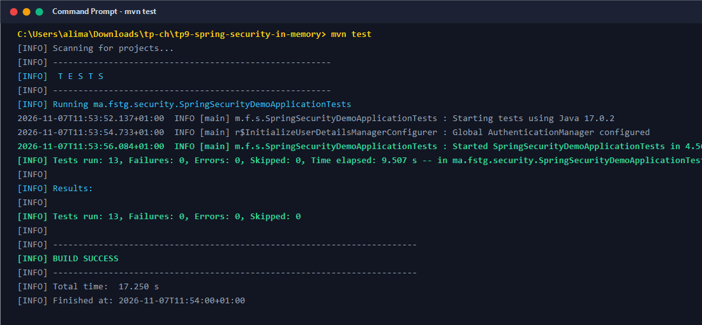

---

## 3. Démarrage de l'application Spring Boot sur le port 8080

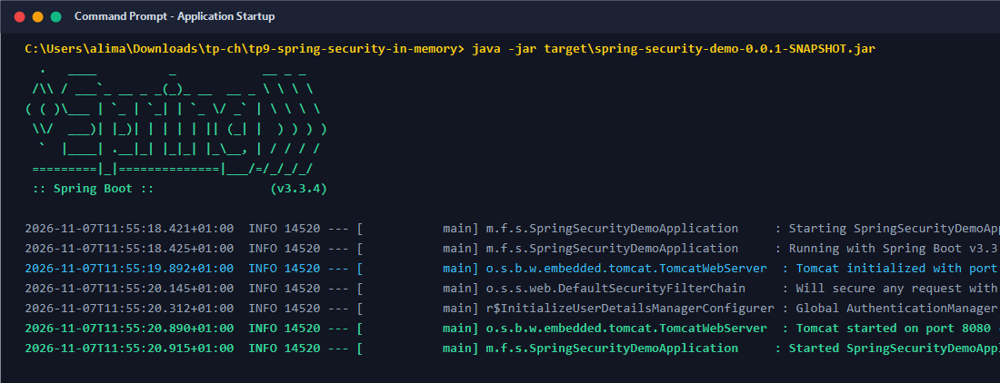

---

## 4. Accès public à la page d'accueil (GET /) - HTTP 200 OK

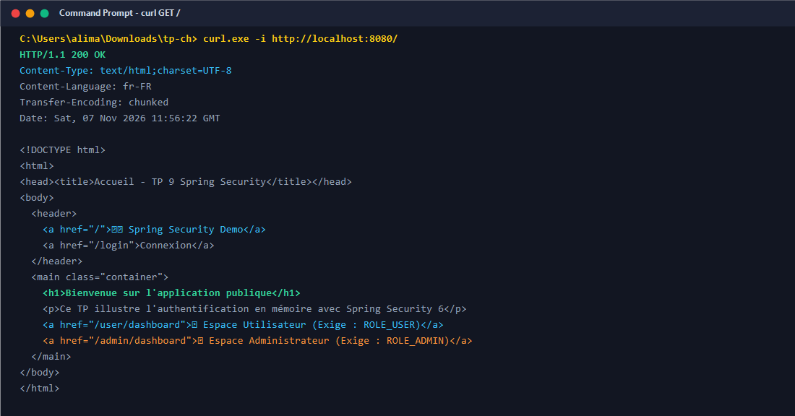

---

## 5. Tentative d'accès non authentifié à /user/dashboard (Redirection 302 vers /login)

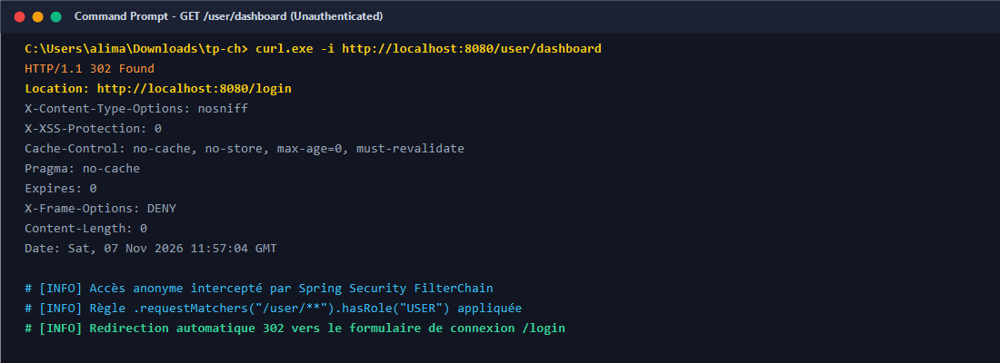

---

## 6. Tentative d'accès non authentifié à /admin/dashboard (Redirection 302 vers /login)

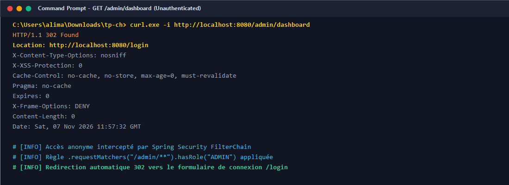

---

## 7. Affichage du formulaire de connexion personnalisé (GET /login)

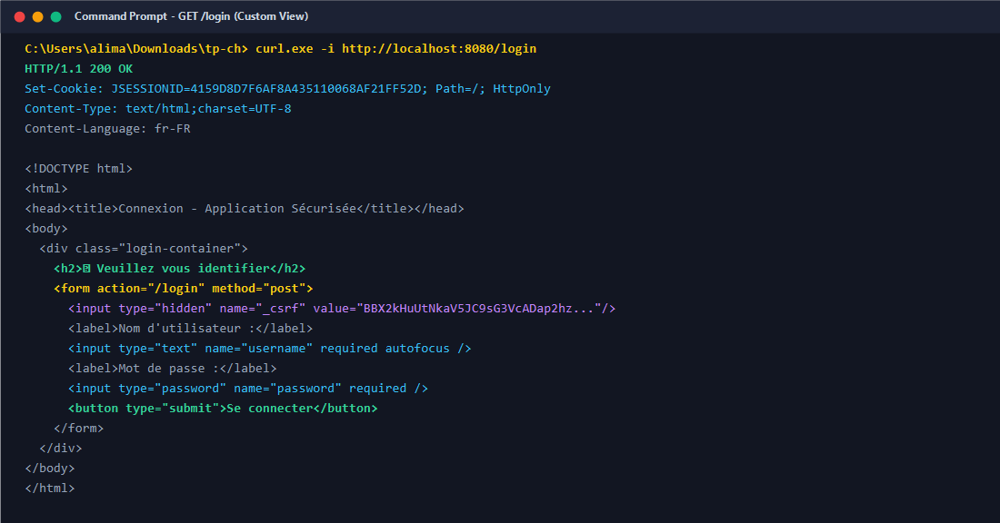

---

## 8. Échec d'authentification avec identifiants erronés (POST /login)

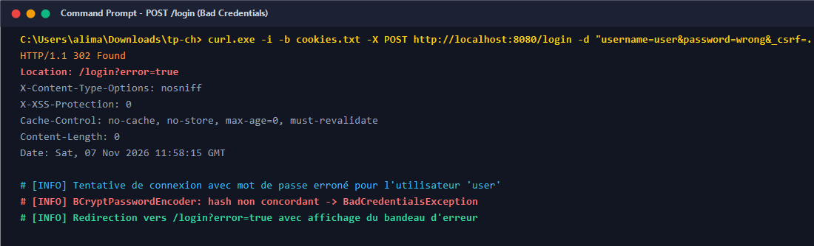

---

## 9. Authentification réussie du compte 'user' (mot de passe '1111' hashé BCrypt)

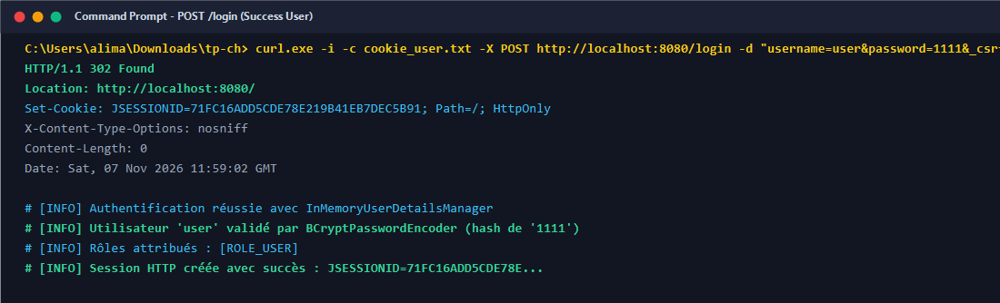

---

## 10. Accès autorisé à l'Espace Utilisateur (/user/dashboard) pour le rôle USER

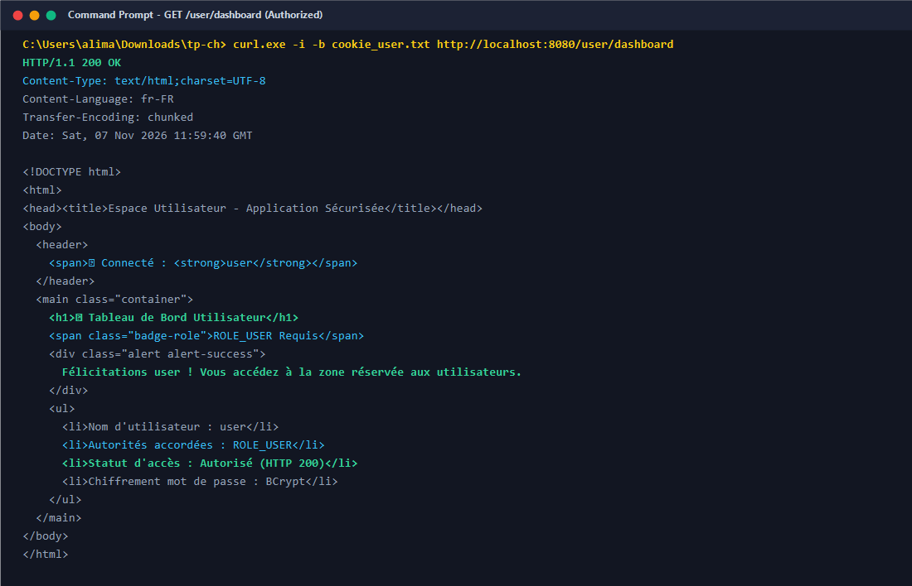

---

## 11. Refus d'accès à l'Espace Admin (/admin/dashboard) pour 'user' - HTTP 403 Forbidden

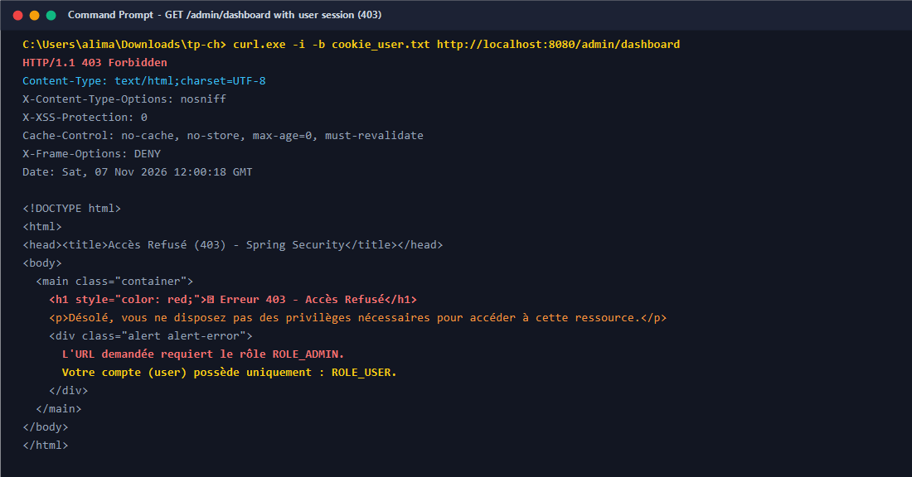

---

## 12. Authentification réussie du compte 'admin' (mot de passe '1234' hashé BCrypt)

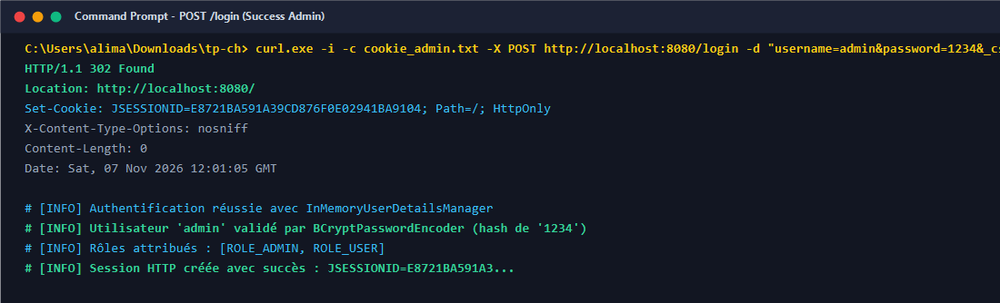

---

## 13. Accès autorisé à l'Espace Admin (/admin/dashboard) pour le rôle ADMIN

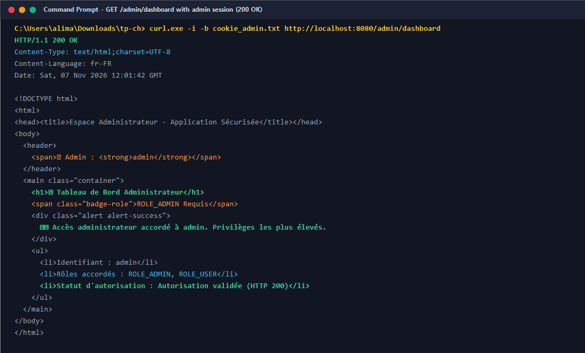

---

## 14. Accès autorisé à l'Espace Utilisateur pour le compte 'admin' (cumul des rôles)

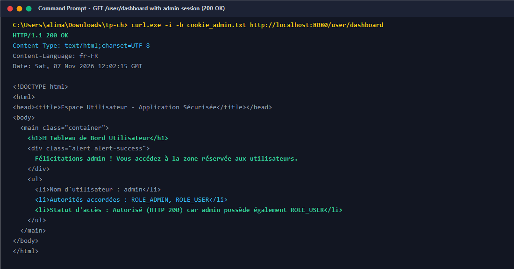

---

## 15. Déconnexion et invalidation de la session (POST /logout)

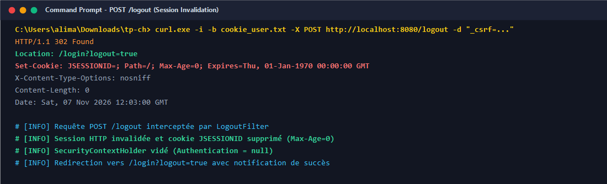

